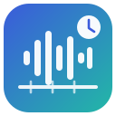

# 会议纪要（dsh-meeting-minutes）

DeepSeek Harness 右侧栏插件。参考 [notta-input](../../notta-input) 的生活日志与会议转写设计，把「今天说了什么」直接变成可回看的时间轴、区间转写和时间线纪要。



## 它做什么

右侧栏新增一个「会议纪要」标签，内含两个 tab：

### 今日

- 上半部分是**语音密度时间轴**，横轴 06:00–24:00，每小时一个刻度；纵轴是 VAD 语音密度（每分钟被 VAD 判为语音的秒数占比），按 5 分钟聚合成柱状图。
- 每个柱子的深浅表示密度高低；灰色短条表示那一分钟没有采集数据（不是静音）。
- 鼠标拖拽选择区间；单击选择以点击点为中心的 1 小时。默认选区是最近 2 小时，可一键「最近 2 小时 / 全天」。
- 时间轴下方是 **「AI 生成纪要」** 按钮和生成状态：生成中显示读秒，完成后显示「已生成 · N 场 · 耗时」，并提示去「纪要」tab 查看；失败会显示模型错误和重试提示。
- 已有纪要会画在时间轴下方：绿色长条标出 `HH:mm–HH:mm`（鼠标悬停显示主题），同时在图上叠加淡绿色竖带与虚线边界；当前选区与已有纪要重叠时，生成条会提示「该选区已有纪要，生成会替换」，避免重复生成。
- 支持并发：一个区间在生成时，可以继续改选区、再点生成，多个任务各自读秒、各自完成；任务列表最多保留最近 5 条。
- 下半部分显示选区内 SenseVoice 转写：时间、轨道（麦克风 / 系统声音 / 会议）和文本，可按轨道过滤、一键复制。选区变化不再请求服务，纯前端过滤，拖动时即时更新。
- 数据每 15 秒自动刷新（页面可见时），切回窗口也会立即刷新；统计行显示「更新于 HH:mm:ss」。如果选区末尾还没有数据，或已采集但 ASR 还没落字，转写区会直接说明原因。

### 背景

- 独立 tab 管理「背景卡片」：标题、标签（可多选筛选）、背景内容，支持新增 / 编辑 / 删除。
- 适合放项目背景、人名、术语、历史决策；生成纪要时在「今日」勾选需要的卡片，内容会随转写一起交给模型，帮助消歧。
- 可以勾选的卡片数量没有硬限制，提示词里会按每张 1.6k 字、总计 6k 字裁剪，避免挤掉转写。
- 卡片和勾选状态都存本地：`backgrounds.json` 与 `background-selection.json`。

### 纪要

- 按时间线整理：`HH:mm–HH:mm · 主题`，每段含时间、主题、概述、内容要点、TODO。
- 生成入口在「今日」时间轴下方（不在本 tab）。生成时可以多选背景卡片（见「背景」tab），勾选内容会作为背景资料随转写交给模型。「AI 生成纪要」把选区的 SenseVoice 转写交给 Host 当前模型整理：默认**整段是一场会议，只产出一条**；只有转写里出现明确的换场标志（「下一个议题」「今天先到这」「散会」等）才拆成多条，并且解析器还会二次兜底合并过度的拆分。
- 生成会替换该区间内的旧条目；并发生成时按各自区间落盘，后完成的结果不会覆盖先完成的其他区间。随后可编辑（时间 / 主题 / 概述 / 内容 / TODO）、可删、可新增时段；保存即落盘。
- 模型路由默认跟随 Host 的默认模型（本机是 `deepseek-official/deepseek-flash`），也可以在插件配置里写 `provider` / `model` 覆盖。
- Agent 也可以用工具写入或重新生成，面板刷新即可看到。

## 数据从哪来

只读 [notta-input](../../notta-input) 的 LifeLog 日目录，不写入、不改动：

```
<lifelogRoot>/2026-11-10/
  activity.jsonl   # 每分钟 VAD 语音秒数、字数（密度来源）
  snippets.jsonl   # SenseVoice 转写片段（startAt/endAt 为 UTC）
```

自动探测顺序（取最新一天所在的根目录）：

1. `~/Downloads/notta`
2. `~/Documents/notta生活日志`
3. `~/Documents/notta`

也可显式指定：插件配置 `lifelogRoot`，或环境变量 `MEETING_MINUTES_LIFELOG`。
时间按系统时区换算，可用配置 `timeZone`（如 `Asia/Shanghai`）覆盖。

> 插件不做录音、不跑推理：VAD 与 SenseVoice 由 notta-input 在采集时完成，本插件消费它的输出。所以使用前 notta-input 需要处于生活日志采集状态。

## 本地存储

```
$DSH_HOME/meeting-minutes/
  state.json                 # 最近一次选区
  backgrounds.json           # 背景卡片（标题、标签、内容）
  background-selection.json  # 生成时勾选的背景卡片 id
  minutes/2026-11-10.json    # 纪要（结构化，面板读写）
  minutes/2026-11-10.md      # 同内容的 Markdown，可直接阅读/转发
```

Markdown 形如：

```markdown
## 15:00–15:20 · 插件面板

- **时间**：15:00–15:20
- **主题**：插件面板
- **概述**：检查时间轴和转写联动。
- **内容**：
  - 密度时间轴按 5 分钟聚合
  - 选区默认最近两小时
- **TODO**：
  - [ ] 明早补一次暗色模式检查
```

## Agent 工具

| 工具 | 用途 |
| --- | --- |
| `meeting_minutes_today` | 当天每小时密度、语音分钟数、字数、当前选区、纪要路径 |
| `meeting_minutes_transcript` | 取某区间转写原文（`[HH:mm:ss] 轨道：文本`） |
| `meeting_minutes_generate` | 用当前模型把区间转写整理成纪要并落盘（默认一场会议，可传 `backgroundIds`） |
| `meeting_minutes_save` | 按时间线写入/覆盖纪要（`时间点 + 主题 + 内容 + TODO`） |
| `meeting_minutes_read` | 读回当天已写纪要，便于续写 |

典型用法：

> 「把今天 14:00–16:00 整理成会议纪要，按时间线，重点标 TODO」

可以直接让 Agent 调 `meeting_minutes_generate`（与面板按钮同一条模型路径），也可以用 `meeting_minutes_transcript` 取原文后 `meeting_minutes_save` 写入自己的版本；面板「纪要」tab 刷新可见。

## 结构

```
src/
  config.ts        # 日志根探测、插件数据目录、时区、模型路由
  lifelog.ts       # activity.jsonl / snippets.jsonl 解析；密度、区间切片
  ai.ts            # 纪要提示词（含背景资料）、转写裁剪、模型 JSON 解析与单会兜底
  backgrounds.ts   # 背景卡片存储与勾选状态
  minutes.ts       # 纪要 JSON/Markdown 存储
  service.ts       # 面板与 Agent 共用的领域逻辑（含模型调用）
  rpc.ts           # /dsh-meeting-minutes/rpc
  index.ts         # Host 入口 + 5 个工具
  client/
    index.ts       # 右侧栏 tab 注册
    timeline.tsx   # 可复用时间轴组件（SVG、拖拽选区、悬浮读数）
    panel.tsx      # 今日 / 纪要 两个 tab
    labels.ts      # zh / en 文案
scripts/           # esbuild 构建与 bundle 自检
```

时间轴是一个独立组件 `TimelineChart`：输入 `buckets / start / end / selection`，输出拖拽选区与悬浮读数，不依赖图表库（浏览器端只允许 `react`），样式全部走 Host 主题 token，明暗色自动跟随。

## 构建与安装

```bash
node scripts/build-host.mjs
node scripts/build-client.mjs
node scripts/check-client.mjs
```

然后用 `plugin_manager` 的 `install_bundle` 安装本目录（绝对路径）。安装后在右侧栏打开「会议纪要」。

## 已知边界

- AI 生成会把**该选区的转写文本**和**你勾选的背景卡片内容**发送给当前配置的模型提供方；除此之外的日志读取和纪要存储都在本机。介意的话请改用 Agent 工具 + 本地模型，或不要点生成。
- 生成质量取决于模型与 ASR 质量；生成本身会替换区间内已有条目，重要内容请先复制或先手动保存。
- 一个自然日一个纪要文件；跨零点的会按本地日期拆开。
- 只读 notta 日志，不负责录屏/录音权限。
