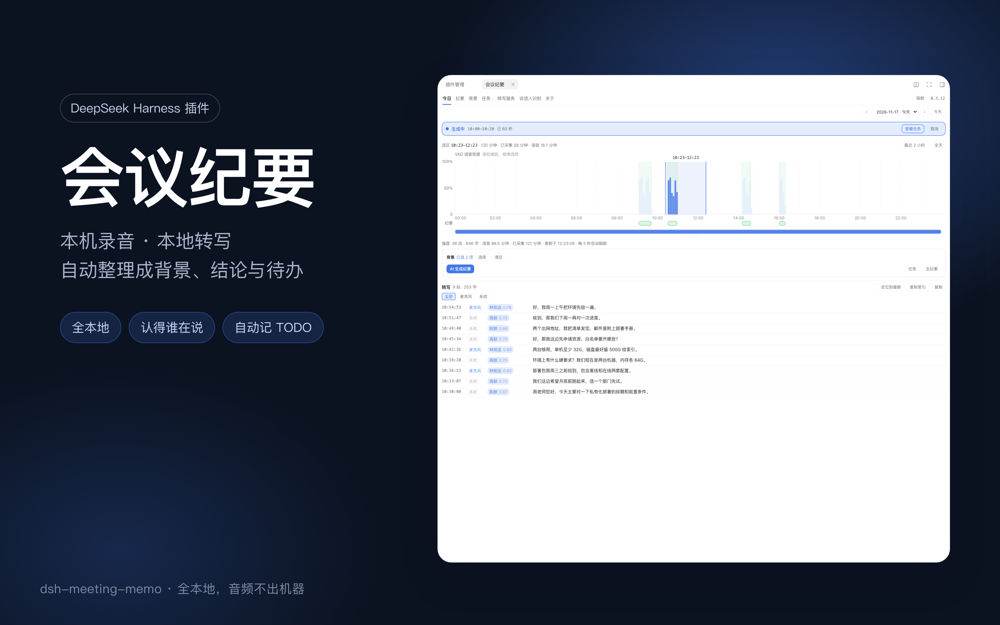
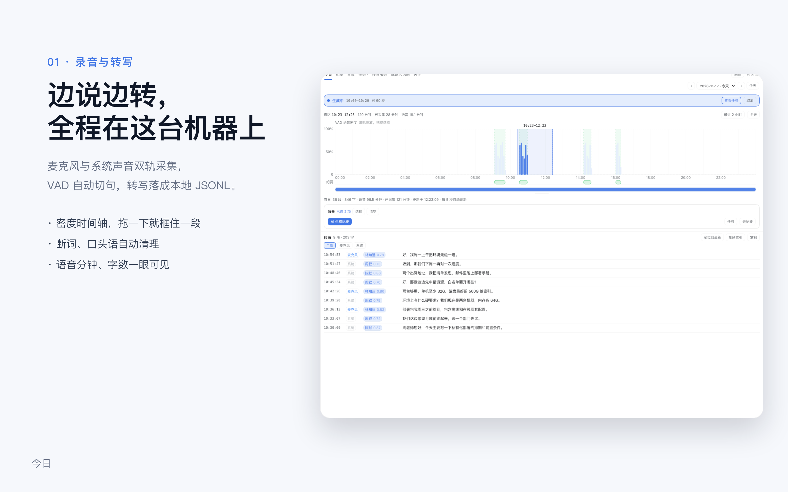
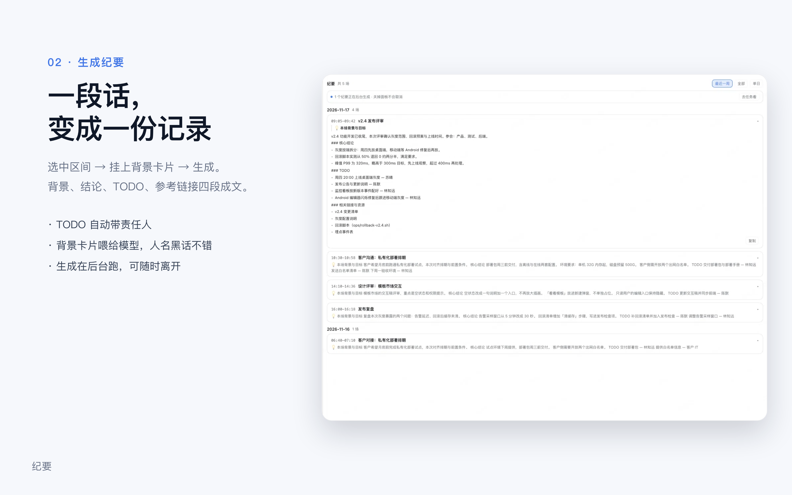
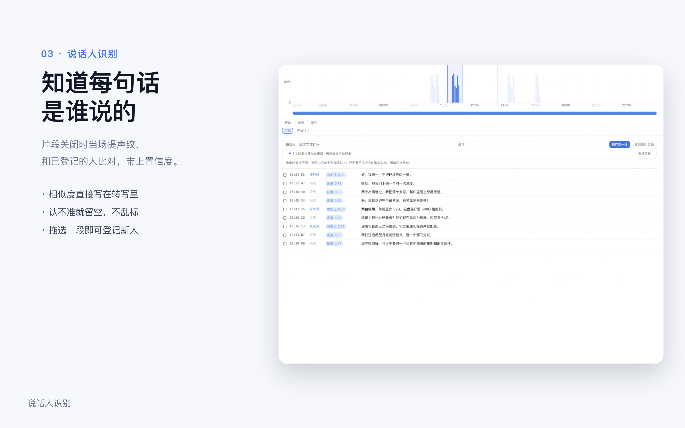
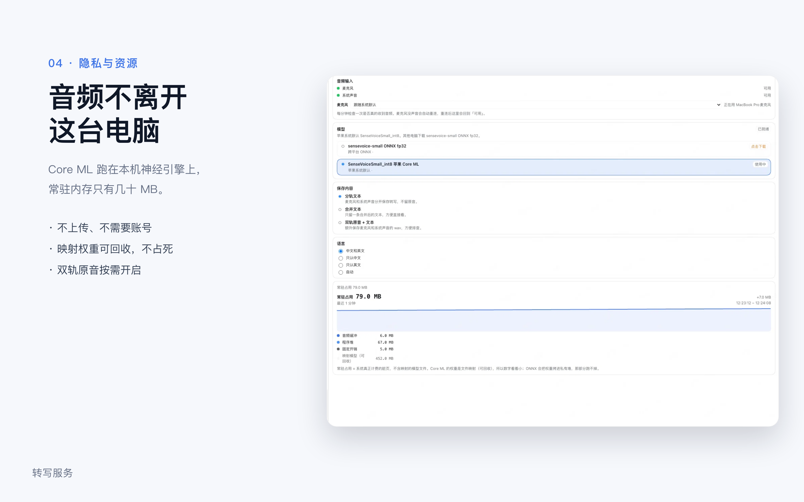
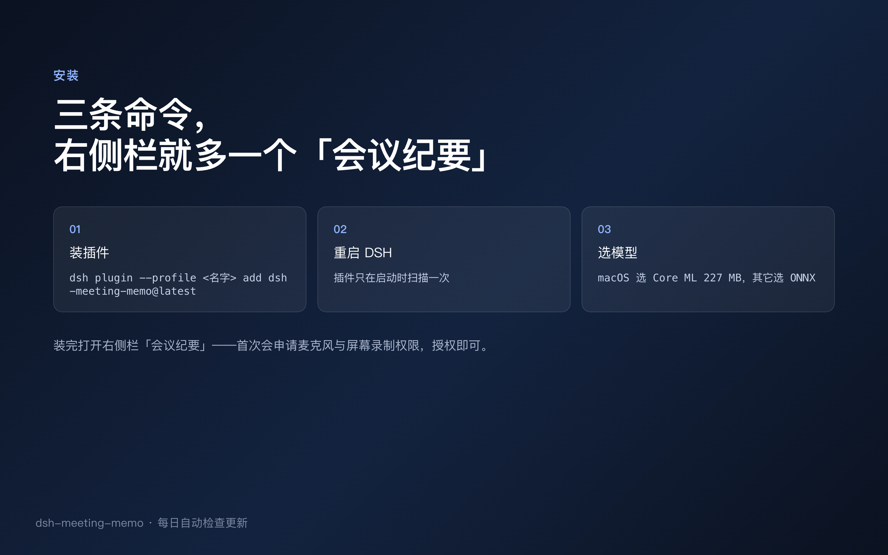

# dsh-meeting-memo · 会议纪要

DeepSeek Harness 右侧栏的会议纪要插件。在本机录下会议、用本地语音模型转成文字，再把选中的一段整理成结构化纪要：背景、要点、决策、待办。音频和文字都不离开这台机器。



## 安装

```bash
# 从 npm
dsh plugin --profile <你的 profile> add dsh-meeting-memo

# 或直接从 GitHub（首次会自动构建）
dsh plugin --profile <你的 profile> add github:jqlong17/dsh-meeting-memo
```

装完**重启 DSH**：插件只在启动时扫描一次。

首次使用会申请麦克风和屏幕录制权限——前者录你说的话，后者录会议另一端的声音。

语音模型在「转写服务」里下载，插件会按系统给出对应选项：

- **macOS**：SenseVoiceSmall_int8（苹果 Core ML，约 227 MB），走神经引擎，内存占用明显更小。
- **其它系统**：sensevoice-small ONNX fp32（约 1 GB）。

## 面板里有什么

| 标签 | 用途 |
| --- | --- |
| 今日 | 06:00–24:00 的语音密度；拖选一段看转写，滚轮缩放，拖底部滑块平移 |
| 纪要 | 整理好的纪要，按场次列出背景、要点、决策、待办；写法可自己改 |
| 背景 | 项目、人名、术语卡片，生成时勾选带上 |
| 任务 | 生成任务的进度与历史 |
| 转写服务 | 模型、语言、分轨和录音设置 |
| 关于 | 产品说明，以及一段可直接转发的安装话术 |

关掉插件后不再录音、不再整理。已经写下的纪要和背景留在本机。

## 界面

| 边说边转，全程在本机 | 一段话变成一份记录 |
| --- | --- |
|  |  |

| 知道每句话是谁说的 | 音频不离开这台电脑 |
| --- | --- |
|  |  |

截图来自插件的**演示模式**（关于 → 演示模式），人物、公司、会议内容都是虚构的。

## 安装步骤一览



## 说话人识别的打标

「说话人识别」标签用来攒训练数据：开会时点「开始」，对方说完点「结束」，填一个名字保存。每条标签记录日期、起止时间和说话人，并自动对应那段时间落下的 wav。

要让它有音频可用，保存内容必须是**双轨原音 + 文本**（「转写服务」里可切）。切过去之后每个转写片段会额外写一个 wav 到 `asr-log/<日期>/audio/<轨道>/<毫秒>.wav`，转写本身不受影响。

标签存在 `speaker-labels.json`，和 wav 一起构成「时间区间 + 人工标签 + 原音」的素材，后面接音色分离/声纹聚类时直接可用。


## 声纹（说话人识别）

`sherpa-onnx` 的 CAM++ 声纹模型可以把一段音频压成 192 维向量，两条向量余弦相似度就是"像不像同一个人"。

验证脚本（需要先 `npm run build:native`，会顺带编译 `bin/embed`）：

```bash
python3 scripts/speaker-eval.py 2026-11-16
```

用当天已标注片段做留一验证，再用这些人的质心给全天片段分配说话人。当前实测：

- 留一验证 22/22 正确
- 同人相似度均值 0.870、异人 0.195
- 全天 125 个片段，阈值 0.65 时 74% 能归到已登记的人，其余标为未识别


## 自动更新

**每天自动查一次**（状态记在 `update-state.json`，重启后不会重复查，也不会漏掉一整天）：

- 装了 npm 版并且开了 `autoUpdate`（默认开）→ 发现新版本会**自动升级**，面板顶部提示「已自动更新到 x.y.z，重启后生效」
- 关掉自动升级（配置 `autoUpdate: false`，或环境变量 `MEETING_MINUTES_AUTO_UPDATE=0`）→ 只提示，点「现在更新」才执行

升级命令是

```bash
dsh plugin --profile <你的profile> add dsh-meeting-memo@latest
```

然后提示重启 DeepSeek Harness 生效。不会自己重启——重启会打断正在进行的录音和会话。

开发模式（profile 里依赖写成 `link:`）不会做任何更新检查，避免把本地代码换成 npm 版。

## 手机上看

DSH Pocket iOS → 「插件」→ 会议纪要 → 打开，就能看到今天采集了多少、以及最近几天的纪要。

页面在 `resources/mobile/`（HTML + CSS），**每次请求重读**，改文案或样式不用重载插件；数据服务端直出，页面里不请求 RPC。

自测不用拿手机：

```bash
npm run check:mobile                       # 默认 http://127.0.0.1:56283
npm run check:mobile -- --base http://127.0.0.1:3091
```

## 它访问什么

这一节是为了让你在装之前就知道边界。

| 资源 | 用途 | 是否离开本机 |
| --- | --- | --- |
| 麦克风 | 采集现场说话 | 否 |
| 屏幕录制（仅系统音频） | 采集会议另一端的声音 | 否 |
| `~/.dsh/meeting-memo/` | 存放纪要、转写、背景卡、模型与运行时 | 否 |
| 本机模型文件 | 你指定目录下的语音模型（如 SenseVoice） | 否 |
| 网络 | 下载你主动选择的语音模型；生成纪要时调用模型 | 录音与转写内容不上传 |

补充两点：

- **飞书链接**：只有你把链接贴进「补充资料」时，才会调用本机的 `lark-cli`（用你自己的登录态）读取文档或表格。不贴就不读。
- **不碰别人的数据**：不写入 notta 生活日志目录，不修改其他插件的配置。

## English


A right-sidebar meeting-minutes plugin for DeepSeek Harness. It records the meeting on this machine, transcribes locally with an on-device speech model, and turns a selected span into structured minutes: background, key points, decisions, and to-dos. Audio and text never leave the machine.

```bash
dsh plugin --profile <profile> add dsh-meeting-memo
```

Restart DSH after installing; plugins are only scanned at startup. The first run asks for microphone and screen-recording permission. Model and recording settings live under **Transcribe**.

**What it touches.** Microphone audio and system audio for capture; `~/.dsh/meeting-memo/` for minutes, transcripts, background cards, models, and the ASR runtime; the network only to download a model you pick, or to call the model when drafting minutes. Nothing recorded or transcribed is uploaded. Feishu links are read through your local `lark-cli` only when you paste them into Extra notes. It does not write to the notta life-log folder or modify other plugins' config.

## 开发

```bash
npm install
npm run build        # lib/index.js + lib/client.js
npm test             # 21 项单测
npm run check:client # 校验打包产物：tab、locale、文案、组件渲染
```

MIT
